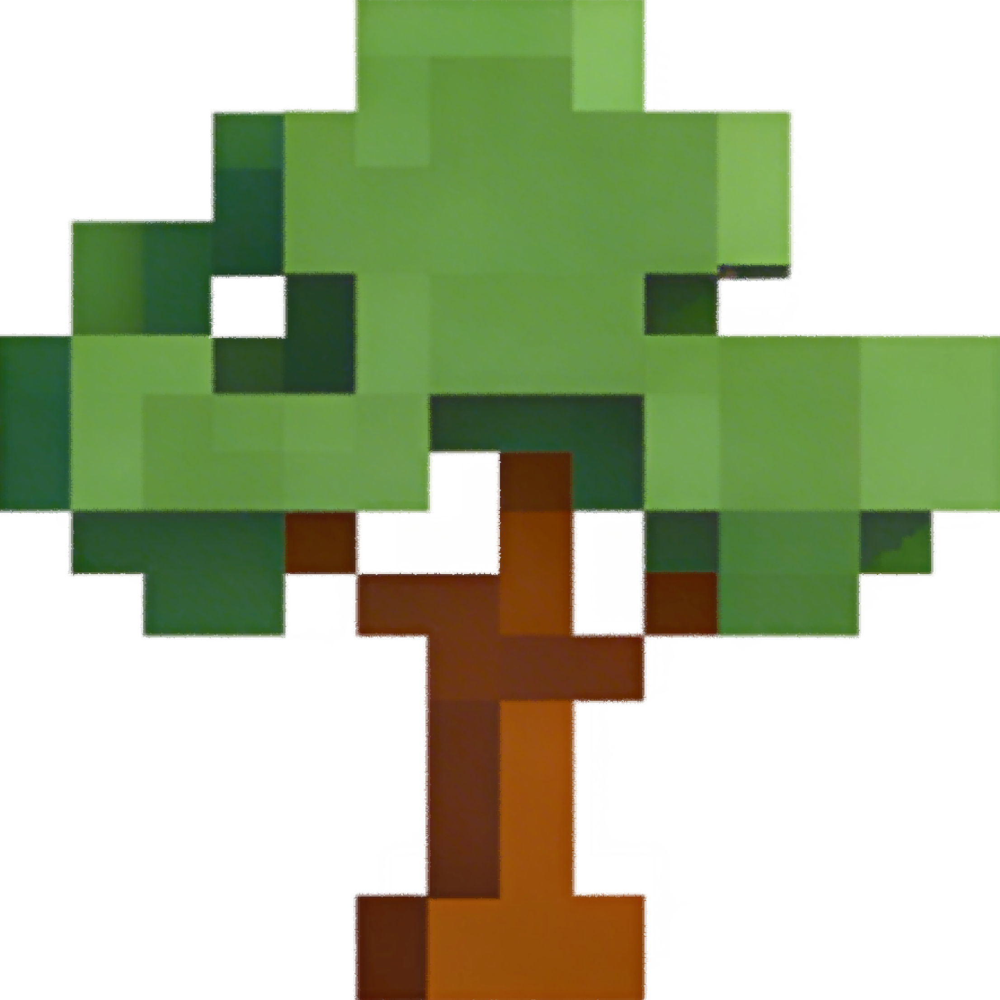

[](https://doi.org/10.5281/zenodo.23591824)
#  LAS to ENVI-met Tree Converter (las2ENVImet)

A QGIS plugin that turns LiDAR point clouds of single trees into 3D plants for the microclimate
model **ENVI-met**: voxel-based leaf area density (LAD), a configurable root system and A-gs
physiology – for **ENVI-met 6** (JSON database) and **ENVI-met 5.x** (classic database).

Version 2.0 · QGIS 3.18 – 4.x (Qt5 and Qt6) · Windows, Linux, macOS

Video tutorial of version 1: https://youtu.be/RTAHIMK8xJE

---

## What is new in 2.0

- Export for **ENVI-met 6** (JSON) in addition to ENVI-met 5.x. The format of an existing database is detected automatically
- Runs under **QGIS 3.18 … 4.x** from one code base
- Foliage by **target LAI** or **total leaf area** as an alternative to reference voxels, with live key figures
- **Root system** with shape, depth, radius, vertical distribution and preview; presets for forest zones and
  common tree species with their literature sources
- More point cloud formats: **LAS, LAZ, COPC, E57, PLY, PCD, OBJ, SBF, XYZ/TXT/CSV/PTS**; class filter, section loading, thinning
- **Step-by-step wizard** with progress bar, cancel button, log panel and tooltips for every parameter
- **Project files** (`*.l2e.json`) store every setting for reproducible results
- Backup before every database change, free-ID suggestion, replace only after confirmation
- German translation

See [CHANGELOG.md](CHANGELOG.md) for details.

**Example data:** sample trees and point clouds in several formats – [download from Seafile](https://seafile.rlp.net/d/24616aa0b0c346adb4a0/).

---

## Installation

1. QGIS: *Plugins → Manage and Install Plugins…* → search for **las2ENVImet** → *Install*.
   (Or download the ZIP and use *Install from ZIP*.)
2. Install the Python packages for the formats you need (see below).
3. Start the plugin from the toolbar or *Plugins → LAS to ENVI-met Tree Converter*.

**From source:** clone or download this repository and copy the folder as `las2ENVImet` into the
QGIS plugin directory (Windows: `%APPDATA%\QGIS\QGIS3\profiles\default\python\plugins\`, Linux:
`~/.local/share/QGIS/QGIS3/profiles/default/python/plugins/`; QGIS 4 uses `QGIS4` instead of
`QGIS3`), restart QGIS and enable the plugin in the plugin manager.

Downloads: [QGIS](https://qgis.org/download/) · [ENVI-met](https://envi-met.info/doku.php?id=files:start)

### Dependencies

The first page of the wizard shows which formats are available and offers the matching
installation command for the clipboard. The plugin always starts; a missing package only disables
its format.

| Package | Needed for | Required |
|---|---|---|
| `numpy` | everything | comes with QGIS |
| `laspy` | LAS | yes |
| `lazrs` | LAZ and COPC (compressed) | for `.laz` / `.copc.laz` |
| `pye57` | E57 | optional |
| `plyfile` | PLY files with unusual properties (plain PLY works without it) | optional |
| `matplotlib` | faster polygon selection | optional, comes with QGIS |

PCD, OBJ, SBF and text formats need no extra package.

**Windows (OSGeo4W / standalone installer):** open the *OSGeo4W Shell* that belongs to your QGIS
version and run

```bat
python -m pip install laspy lazrs
python -m pip install pye57 plyfile
```

If you have no write access to the QGIS folder, add `--user`. Do **not** upgrade `numpy`; QGIS
needs the version it ships. To be safe, pin it:

```bat
python -c "import numpy; print('numpy==' + numpy.__version__)" > constraints.txt
python -m pip install -c constraints.txt laspy lazrs pye57 plyfile
```

**Linux / macOS:** use the Python interpreter QGIS runs with, e.g. `python3 -m pip install --user laspy lazrs pye57 plyfile`.

Restart QGIS afterwards.

Tested combinations (Windows): QGIS 3.18.1 (Qt5, Python 3.9), 3.42.0 (Qt6), 3.44.15 LTR (Qt5),
4.2.3 (Qt6). In QGIS 3.18 the available `pye57` build does not work with the old numpy; the plugin
detects this and disables E57 there – convert such files to LAS/LAZ or use a newer QGIS.

---

## Workflow

The wizard has nine steps. The list on the left shows the state of each step. *Back* / *Next* or a click on a step moves between them; the log at the bottom
lists everything that happened. *Help* opens the section below that belongs to the current step.

### Point cloud formats

Step 1. Choose a point cloud layer that is already loaded in QGIS (its coordinate system is taken
over) or a file:

| Format | Extensions | Notes |
|---|---|---|
| LAS / LAZ | `.las`, `.laz` | versions 1.0–1.4, all point formats |
| COPC | `.copc.laz` | with "current map extent" only the needed part of the file is read |
| E57 | `.e57` | all scans of the file are merged |
| PLY | `.ply` | ASCII and binary |
| PCD | `.pcd` | ASCII, binary, binary_compressed |
| OBJ | `.obj` | vertex lines only (point clouds exported e.g. from CloudCompare) |
| SBF | `.sbf` + `.sbf.data` | CloudCompare simple binary format |
| Text | `.xyz`, `.txt`, `.csv`, `.pts`, `.asc` | delimiter, header and decimal comma are detected; *Text file columns…* lets you assign columns |

Options for large files: load only the current map extent, keep only certain classes
(e.g. 3, 4, 5 = vegetation), thin to one point per cube. Loading runs in the background and can be
cancelled.

### Select the tree

Step 2. If the cloud contains more than one tree, draw a polygon around the tree (left click =
vertex, right click = finish). Skip this step for a cloud of a single tree.

### Filter

Step 3 (optional). Keep certain classes, show or cut a height range (a thin slice near the ground
makes the trunk easy to find), thin the cloud.

### Trunk and transformation

Step 4. Click the trunk centre in the map or let the plugin suggest it (median of the lowest
30 cm). The measured height and crown widths appear. Change the target values to scale the tree,
or rotate it. *Preview in the map* shows the result.

### Voxelisation

Step 5. The tree is converted to 1 m × 1 m × 1 m cells, which is the fixed cell size of ENVI-met 3D
plants, with the trunk in the centre cell. A horizontal slice with point counts (later: LAD) is
shown in the map. Choose the layer with the spin box.

### Foliage: LAD and LAI

Step 6. Three ways to get the leaf area density:

| Mode | You enter | The plugin does |
|---|---|---|
| LAD reference voxels | the known LAD of one or more voxels | scales all other voxels by their point count |
| Target LAI *(default)* | a leaf area index | keeps the relative distribution of the point cloud and scales it so that the LAI is met |
| Total leaf area | one-sided leaf area in m² | same, scaled to the total |

Definitions (cell edge 1 m): total leaf area `LA = Σ LAD · V`; crown projection area `A` = area
of all x/y columns that contain leaves; **`LAI = LA / A`**. Optionally the LAI can refer to
*every column*: then each x/y column reaches the target on its own.

*Refinement* (optional): crown factor for a height range, fixed LAD for the trunk column, removal
of very small values, emptying the ground layer. In LAI / leaf-area mode the target is met again
after a refinement.

*Result* shows LAI, total leaf area, maximum and mean LAD live and warns when voxels exceed the
limit you set (default 3 m²/m³). Cells with LAD ≤ 0.001 m²/m³ are not exported (ENVI-met ignores
them), the scaling already accounts for that.

### Root system

Step 7. ENVI-met describes roots as a body of revolution below the trunk with ten layers. You set:

- **shape**: cylinder, half sphere / ellipsoid, heart root, tap root, flat / plate root, or your own radius profile
- **depth** and **horizontal size** (diameter in metres or a factor of the crown radius)
- **vertical distribution**: uniform, linearly decreasing, exponential (β model, Jackson et al. 1996), logistic
  (50 % and 95 % rooting depth, Schenk & Jackson 2002), or your own profile
- **amount**: mean root area density (RAD, m²/m³) or total root area (m²)

The side view shows crown and root zone to scale. Presets set some of these values; the source of
a preset is shown below the list. *Save as my preset…* stores your own settings under a name (for
example a species at a site) in the QGIS profile. Species presets exist only where a checked literature
value was found (beech, oak, Scots pine, Norway spruce; root system type only for lime, maple, birch,
larch, ash, aspen). The mean RAD keeps the ENVI-met default, see
[docs/root_presets.md](docs/root_presets.md) for all sources and the reasoning.

With *Define the root system* switched off, the ENVI-met 5.x export writes exactly what version 1
wrote (for comparability with older work).

### Physiology (A-gs)

Step 8. Choose a tree type preset or edit the 14 A-gs parameters manually. You can also set albedo,
transmittance, emissivity, leaf type and the twelve monthly foliage factors.

### Export to ENVI-met

Step 9.

- **ENVI-met version**: 6.x (JSON) or 5.x (classic). When you write into an existing database its
  own format is detected and used. A contradiction to your selection is reported.
- **Plant ID**: six characters (0–9, A–Z). *Suggest free ID* finds an unused one.
- **Square plant grid**: ENVI-met 6 stores a single crown width, so its grid is always square (the
  narrower direction is padded with empty cells, the trunk stays centred). For ENVI-met 5.x this is
  optional. Switched off, the grid is written as in version 1.x and can be narrower in one direction.
  The same tree can therefore show a larger *width* in ENVI-met 6 although the foliage is identical.
- **Target**:
  - *new single-plant file* – ENVI-met 6: a database file (`.edb`) containing only this plant, which
    can serve as `projectdatabase.edb` or be imported in the ENVI-met database tools.
    ENVI-met 5.x: the plant definition as text (`.txt`);
  - *existing database* – `projectdatabase.edb` of a project or the user database. A backup
    `<file>.bak_YYYYMMDD-HHMMSS` is written first. If the ID exists you are asked before it is
    replaced; all other entries and unknown fields stay untouched.

In ENVI-met: open the project, place the plant with its ID in SPACES. (A project uses its own
database when *Use project database* is enabled in the project settings.)

### Project files

*Save project…* stores every setting in a `*.l2e.json` file next to your data; *Open project…*
loads the point cloud again and repeats all steps. Paths inside the project folder are stored
relative, so the folder can be moved or shared.

---

## Notes and limits

- ENVI-met 3D plants use 1 m cells; other cell sizes are not supported by the database formats.
- Results depend on scan quality: occlusion inside dense crowns reduces point counts there.
- The LAI orientation values in the tooltip and the root presets are aids, not limits.

## Development

```
core/        domain logic (numpy only): voxelisation, foliage, roots, tree model, project files
readers/     one reader per point cloud format
exporters/   one exporter per ENVI-met format version
gui/         QGIS / Qt user interface
i18n/        translations (build_translations.py writes .ts and .qm)
```

`scripts/build_release.py` builds the plugin ZIP.

## Examples
- The following link contains three sample point clouds from three different laser scanners, representing various trees and tree heights.
  You can download the example point clouds [here](https://seafile.rlp.net/d/d8f4f7f9b624402f9a70/).
- It has come to our attention that, for some users, QGIS cannot access all file paths on their PC.
- If you encounter problems loading the point clouds, we therefore currently recommend placing the point cloud directly in a folder to which the QGIS environment has unrestricted access and write permissions.
- It often works if you place the LAS file directly in the Downloads folder and specify this path in the plugin.

## Use cases

- Deriving physically consistent ENVI-met trees from terrestrial or mobile LiDAR scans
- Parameterising urban street trees with realistic LAD, root zone and A-gs values
- Sensitivity analyses of tree geometry, LAI or rooting versus microclimate impact
- Reproducible tree libraries from measured point clouds for research and teaching

## Contributing and contact

Bug reports, feature requests and pull requests are welcome:
[issue tracker](https://github.com/peer-schoeneberger/las2ENVImet/issues).

Peer Schöneberger, Johannes Gutenberg University Mainz

## Citation
If you use this plugin in scientific work, please cite the archived software version:

Schöneberger, P. (2026). LAS to ENVI-met Tree Converter (las2ENVImet), Version 1.2. Zenodo. https://doi.org/10.5281/zenodo.23591824

A peer-reviewed publication describing the workflow is currently under review; the reference will be added here once available.

Licence: see [LICENSE](LICENSE).
